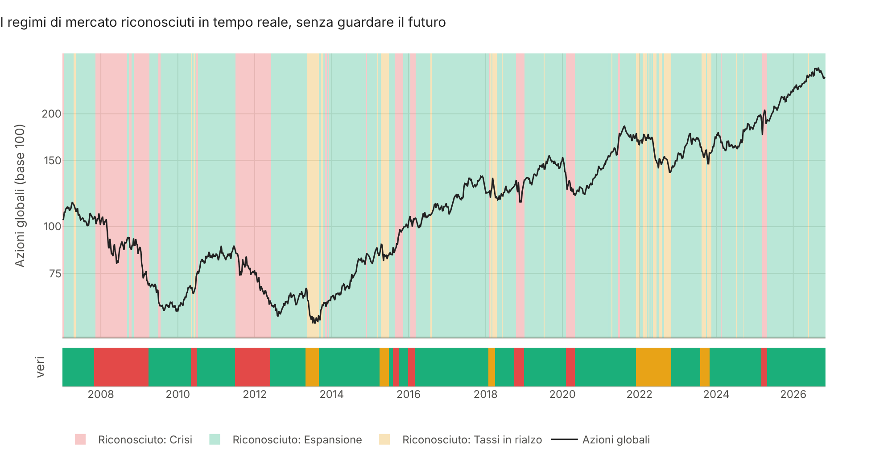
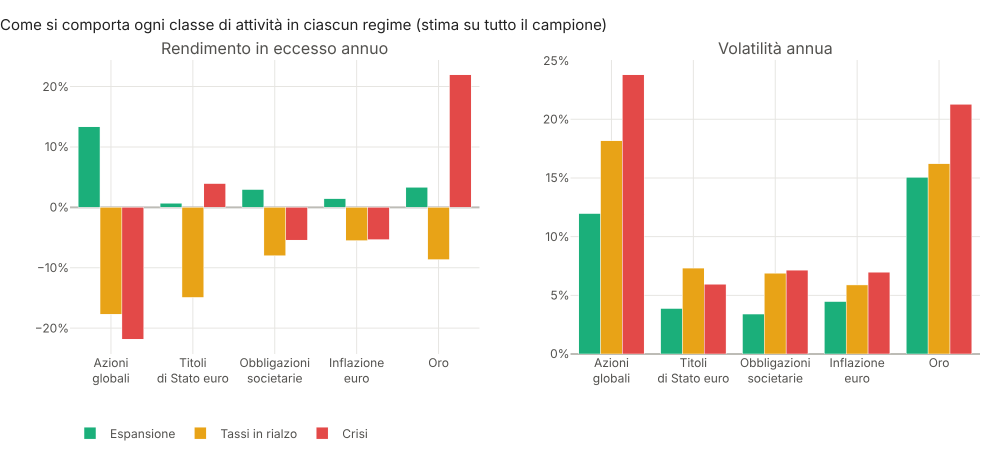
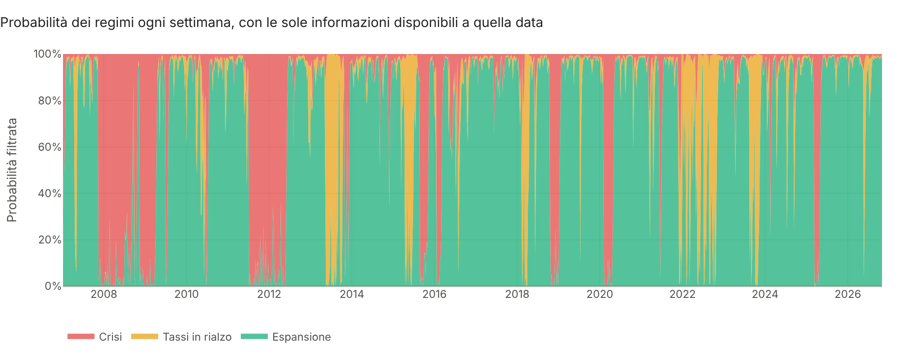
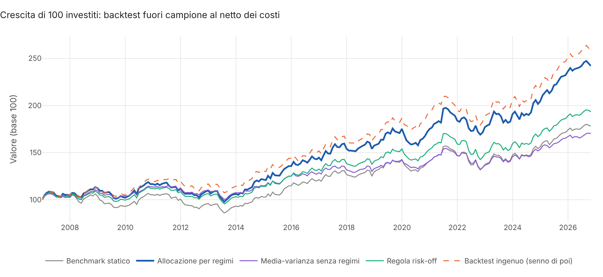
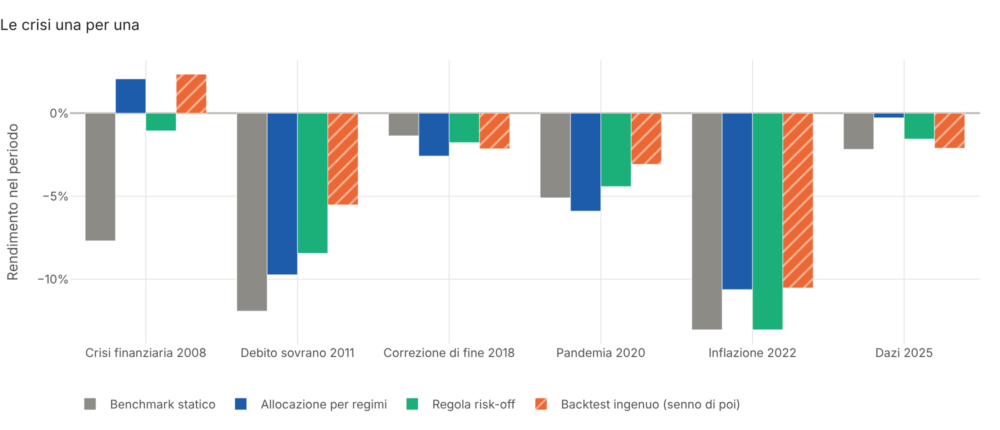
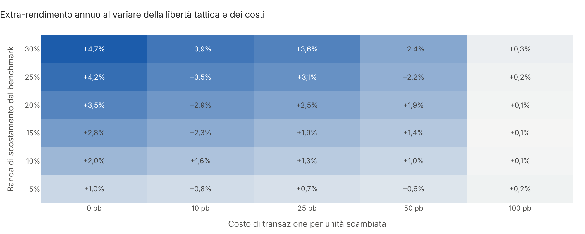
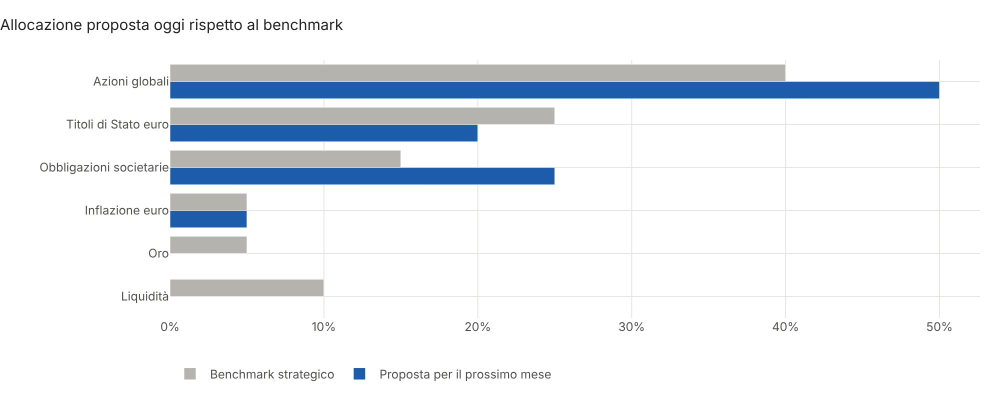

# Regime Allocation

**Regimi di mercato e allocazione tattica in Python: Hidden Markov Model scritto da zero, regimi riconosciuti in
tempo reale, portafoglio che si adatta al regime entro i limiti del mandato, backtest walk-forward contro un
benchmark statico, test di significatività e confronto con un backtest «con il senno di poi».**

I mercati non si comportano sempre allo stesso modo. Ci sono anni tranquilli in cui le azioni salgono con poca
volatilità, crisi in cui crollano e i titoli di Stato fanno da paracadute, e fasi come il 2022 in cui l'inflazione fa
salire i tassi e **azioni e obbligazioni perdono insieme**. Un portafoglio fermo attraversa tutte queste fasi con gli
stessi pesi. Il progetto risponde alle domande che un consulente si pone davanti a un'allocazione tattica: **in che
regime siamo oggi? Quanto presto ci si accorge che il regime è cambiato? Spostare i pesi in base al regime migliora
davvero il rapporto tra rendimento e rischio, al netto dei costi e senza guardare il futuro? E quanto di quello che
promettono i backtest è un'illusione?** Il risultato è un **report HTML interattivo** con la proposta di allocazione
per il mese successivo, in euro.



## Cosa fa

| Area | Contenuto |
|---|---|
| **Hidden Markov Model** | HMM gaussiano multivariato con covarianze piene, stima di massima verosimiglianza con l'algoritmo **EM di Baum-Welch** (ricorsioni scalate), avvii multipli k-means++, prior di persistenza facoltativo; **filtro**, **smoothing**, **Viterbi**, previsione, distribuzione di lungo periodo, durate attese |
| **Regimi** | Stima su azioni, titoli di Stato e obbligazioni societarie, regimi ordinati per volatilità e chiamati per nome (**Espansione**, **Tassi in rialzo**, **Crisi**); rendimenti, volatilità e correlazioni di ogni classe di attività in ogni regime; scelta del numero di regimi con **BIC** e **AIC** |
| **Allocazione tattica** | Momenti della **mistura dei regimi** con le probabilità del mese successivo, rendimenti attesi **ancorati all'equilibrio** del benchmark, ottimizzazione media-varianza entro **bande** dal benchmark strategico, con **costi di transazione** nell'obiettivo |
| **Backtest walk-forward** | A ogni fine mese solo i dati disponibili: ristima periodica, probabilità filtrate aggiornate ogni settimana, ribilanciamento mensile con deriva dei pesi e costi |
| **Confronti** | Benchmark statico, media-varianza **senza regimi**, **regola risk-off** semplice e **backtest ingenuo** con il senno di poi, per misurare quanto vale l'errore più comune |
| **Validazione** | **Bootstrap stazionario** (Politis-Romano) della differenza di rendimento e di Sharpe, sensibilità a **bande e costi**, confronto tra 2, 3 e 4 regimi, risultati **per episodio di crisi** e **per regime**; con dati simulati, accuratezza e **ritardo di riconoscimento** rispetto ai regimi veri |
| **Report** | HTML in italiano con 11 grafici interattivi Plotly, tabelle per strategia, episodio e regime, proposta per il prossimo mese in euro |

Tutto è scritto da zero su `numpy`, `scipy` e `pandas`, senza librerie di HMM o di backtest «a scatola chiusa», così
ogni passaggio è verificabile. Grafici `plotly`, report `jinja2`.

## Avvio rapido

```bash
git clone https://github.com/Torraf-MI/regime-allocation.git
cd regime-allocation
pip install -e ".[png]"

# Report con dati e benchmark dimostrativi (circa un minuto e mezzo)
regime-allocation --demo --cliente "Famiglia Rossi" --capitale 500000

# Senza il confronto con 2 e 4 regimi (più veloce)
regime-allocation --demo --veloce

# Un cliente descritto in un file JSON, con i grafici anche in PNG
regime-allocation --config esempi/cliente.json --grafici output/img

# Report utilizzabile senza rete (plotly.js incluso nel file)
regime-allocation --demo --offline
```

Il report viene salvato in `output/report.html`. Un esempio già generato:
[`docs/report_esempio.html`](docs/report_esempio.html).

Il file JSON ([`esempi/cliente.json`](esempi/cliente.json)) indica i rendimenti (CSV settimanale o mensile, una
colonna per classe di attività), il benchmark strategico e i parametri della strategia:

```json
"benchmark": {"Azioni globali": 0.30, "Titoli di Stato euro": 0.35, "Obbligazioni societarie": 0.15,
              "Inflazione euro": 0.05, "Oro": 0.05, "Liquidità": 0.10},
"caratteristiche": ["Azioni globali", "Titoli di Stato euro", "Obbligazioni societarie"],
"regimi": 3, "banda": 0.10, "bande": {"Oro": 0.05}, "costo": 0.0010, "inizio_test": "2007-01"
```

## Uso come libreria

```python
from regime_allocation import Parametri, dati, metriche, simula, stima_regimi, walk_forward
from regime_allocation.configurazione import CARATTERISTICHE

r = dati.rendimenti_dimostrativi()                       # settimanali, sei classi di attività dal 2000

s = stima_regimi(r, CARATTERISTICHE, "Liquidità", n_regimi=3)
print(s.nomi, s.durate_mesi())                            # Espansione, Tassi in rialzo, Crisi
print(s.correlazione("Azioni globali", "Titoli di Stato euro"))
oggi = s.filtrate(r).iloc[-1]                             # probabilità con i soli dati fino a oggi
print(s.prossimo_mese(oggi.values))                       # quota attesa del mese prossimo in ogni regime

par = Parametri(list(CARATTERISTICHE), "Liquidità", inizio_test="2007-01", banda=0.10)
prev = walk_forward(r, par)                               # nessun dato futuro a nessuna data
regimi = simula("Per regimi", "regimi", prev, r, dati.BENCHMARK, par)
bench = simula("Benchmark", "benchmark", prev, r, dati.BENCHMARK, par)
rf = dati.mensili(r)["Liquidità"].loc[bench.rendimenti.index]
print(metriche(regimi.rendimenti, rf, bench.rendimenti))
```

Esempio completo in [`examples/esempio.py`](examples/esempio.py). Il modello HMM si usa anche da solo:
`stima_hmm(X, 3)` restituisce un `ModelloHMM` con `filtra`, `liscia`, `viterbi`, `prevedi`, `bic`, `simula`.

## Risultati sull'esempio dimostrativo

I dati sono **simulati**: rendimenti settimanali dal gennaio 2000 all'ottobre 2026 di azioni globali, titoli di Stato
euro, obbligazioni societarie, titoli indicizzati all'inflazione, oro e liquidità (Euribor). Ogni mese ha un regime
«vero» fissato dal calendario degli episodi reali (bolla tecnologica, 2008, debito sovrano, pandemia, inflazione del
2022, dazi del 2025) e i rendimenti hanno code più spesse della normale. Il modello non conosce il calendario: lo deve
ritrovare dai rendimenti, e conoscere la verità permette di misurare quanto ci riesce. Il cliente ha un profilo
moderato: 40% azioni, 25% titoli di Stato, 15% obbligazioni societarie, 5% inflazione, 5% oro, 10% liquidità.

**I regimi.** Il BIC sceglie tre regimi, gli stessi della simulazione. In **Espansione** (68% del tempo, episodi di
6,6 mesi in media) le azioni rendono il 13% sopra la liquidità con una volatilità del 12%. In **Crisi** (20%) perdono
il 22% annuo con volatilità doppia, mentre titoli di Stato e oro guadagnano. Con i **Tassi in rialzo** (12%) cambia la
cosa più importante, la **correlazione** tra azioni e titoli di Stato: da −0,47 nelle crisi a +0,56. Proprio quando
servirebbe, la diversificazione classica smette di funzionare.



**Quanto bene li riconosce.** Fuori campione, settimana per settimana, il regime più probabile è quello giusto nel
**90%** dei casi, con un ritardo medio di **2 settimane** dall'inizio di un episodio. La crisi del 2008 è riconosciuta
dopo 2 settimane, quella del 2011 dopo una, il rialzo dei tassi del 2022 subito. Ma ci sono anche 48 settimane di falsi
allarmi su 1.035, e la breve crisi della primavera 2010 viene vista quasi solo alla fine.



**Il backtest fuori campione** (gennaio 2007 – ottobre 2026, 238 mesi, ribilanciamento mensile, costi di 10 punti base
per euro scambiato, bande di ±10% dal benchmark):

| Strategia | Rendimento annuo | Volatilità | Sharpe | Max drawdown | Extra-rendimento | Rotazione annua |
|---|---|---|---|---|---|---|
| Benchmark statico | 3,0% | 6,7% | 0,30 | −20,0% | – | 21% |
| **Allocazione per regimi** | **4,6%** | 7,2% | **0,50** | **−17,6%** | **+1,60%** | 192% |
| Media-varianza senza regimi | 2,7% | 5,4% | 0,32 | −14,4% | −0,24% | 22% |
| Regola risk-off | 3,4% | 6,3% | 0,38 | −16,2% | +0,43% | 68% |
| *Backtest ingenuo (senno di poi)* | *4,9%* | *6,6%* | *0,59* | *−14,6%* | *+1,94%* | *133%* |

L'allocazione per regimi fa meglio del benchmark in tutti e tre i regimi: perde meno nelle crisi (−2,0% annuo contro
−5,3%) e nelle fasi di tassi in rialzo (−10,2% contro −12,3%) e guadagna di più in espansione (+8,8% contro +7,6%),
perché lì può prendere più rischio. La stessa ottimizzazione **senza regimi** non aggiunge nulla: il valore viene
dall'informazione sul regime, non dall'ottimizzatore. La regola risk-off semplice protegge un po' ma rinuncia al
guadagno in espansione.



**Le crisi una per una.** Il modello brilla nelle crisi lunghe e arriva tardi in quelle improvvise:

| Episodio | Benchmark | Per regimi | Backtest ingenuo |
|---|---|---|---|
| Crisi finanziaria 2008 (11/2007 – 3/2009) | −7,7% | **+2,1%** | +2,3% |
| Debito sovrano 2011 (7/2011 – 5/2012) | −11,9% | −9,7% | −5,5% |
| Correzione di fine 2018 | −1,4% | −2,6% | −2,1% |
| Pandemia 2020 (2 – 4/2020) | −5,1% | −5,9% | −3,1% |
| Inflazione 2022 (12/2021 – 10/2022) | −13,0% | −10,6% | −10,5% |
| Dazi 2025 | −2,2% | −0,3% | −2,1% |

Nella pandemia il portafoglio era sovrappesato in azioni perché il regime precedente era di espansione, e i pesi
cambiano solo a fine mese: ha perso più del benchmark. Nel 2022 il rifugio non c'era, perché scendevano anche i
titoli di Stato; il modello ha ridotto la perdita portando azioni e titoli di Stato al minimo consentito e la
liquidità al massimo.



**Fortuna o capacità?** Il bootstrap stazionario ricampiona 2.000 volte i mesi a blocchi, conservando la persistenza
delle crisi: l'extra-rendimento resta positivo in tutti i campioni, con un intervallo al 90% da **+0,9% a +2,3%**
annuo, e la differenza di Sharpe va da +0,09 a +0,31. Il risultato non dipende dal numero di regimi (+1,40% con due,
+1,60% con tre, +1,46% con quattro).

**Il senno di poi.** Il backtest ingenuo, con un'unica stima su tutti i dati e le probabilità lisciate del mese in cui
si investe, promette un extra-rendimento più alto (+1,94%), un drawdown più basso (−14,6%) e uno Sharpe di 0,59. La
differenza si concentra proprio negli episodi difficili: nel 2011 il backtest ingenuo «sapeva» della crisi e perdeva
la metà del benchmark, quello onesto quasi quanto il benchmark. Un quinto del guadagno promesso non è replicabile.

**I costi decidono.** La strategia ruota quasi il doppio del portafoglio ogni anno. Con costi di 10 punti base
l'extra-rendimento è +1,6%, ma a 100 punti base sparisce (+0,1%): ha senso solo con ETF o future. Più libertà tattica
rende di più finché i costi restano bassi.



**La proposta di oggi.** A fine ottobre 2026 il regime è di espansione con il 99% di probabilità, e per novembre il
modello attende il 91% di espansione, il 5% di crisi e il 4% di tassi in rialzo. Su € 600.000 propone di portare le
azioni dal 40% al 50% e le obbligazioni societarie dal 15% al 25%, finanziandole con la liquidità, l'oro e una parte
dei titoli di Stato.



**Un'avvertenza onesta.** Nei dati simulati i regimi esistono davvero, durano mesi e hanno caratteristiche stabili,
quindi il modello ha qualcosa da trovare. Sui mercati reali i regimi sono meno netti, cambiano natura nel tempo e il
vantaggio è in genere più piccolo. Il valore del progetto è nel **metodo di validazione**, che vale per qualunque
strategia tattica: niente dati futuri, costi inclusi, confronto con alternative semplici, significatività, robustezza
e la misura di quanto un backtest ingenuo esagera.

## Metodologia in breve

- **HMM**: s<sub>t</sub> catena di Markov con matrice di transizione A; x<sub>t</sub> | s<sub>t</sub> = k ~ N(μₖ, Σₖ)
  sui rendimenti settimanali in eccesso sulla liquidità, standardizzati con media e deviazione standard della sola
  finestra di stima. EM di Baum-Welch con ricorsioni avanti-indietro scalate (Rabiner, 1989), più avvii k-means++ e,
  nel walk-forward, la stima precedente come avvio aggiuntivo.
- **Probabilità**: filtrate P(sₜ | x₁…xₜ) per tutte le decisioni; quota attesa del mese successivo come media di
  pₜA, pₜA², …, pₜA⁴. Le probabilità lisciate P(sₜ | x₁…x<sub>T</sub>) servono solo a stimare i momenti dentro la
  finestra e al backtest ingenuo.
- **Nomi dei regimi**: ordinati per volatilità azionaria; il più calmo è Espansione, il più volatile Crisi, quelli
  intermedi Tassi in rialzo se i titoli di Stato vi perdono, altrimenti Rallentamento.
- **Rendimenti attesi**: μₖ = π + (1 − r)(μ̂ₖ − μ̂), con π = λΣw<sub>b</sub> i rendimenti di equilibrio impliciti nel
  benchmark e r = 50%. Alle probabilità di lungo periodo il portafoglio ottimo è il benchmark.
- **Portafoglio**: μ = Σ pₖμₖ, Σ = Σ pₖ(Σₖ + μₖμₖᵀ) − μμᵀ; massimo di μᵀw − (λ/2)wᵀΣw − c·(12/h)·Σ|w − w₀| con
  w<sub>b</sub> − banda ≤ w ≤ w<sub>b</sub> + banda, acquisti e vendite come variabili esplicite (SLSQP con gradienti
  analitici); λ = 5, costi ammortizzati su h = 3 mesi.
- **Backtest**: decisione all'ultimo giorno di ogni mese con i dati fino a quel giorno, ristima ogni 12 mesi,
  rendimento del mese successivo con i pesi tenuti fermi, costi sulla differenza tra i nuovi pesi e quelli derivati.
- **Significatività**: bootstrap stazionario (Politis e Romano, 1994) con blocchi di lunghezza media 6 mesi sugli
  stessi mesi per strategia e benchmark.

## Struttura

```
src/regime_allocation/
├── hmm.py             # HMM gaussiano: EM, filtro, smoothing, Viterbi, previsione, BIC, simulazione
├── regimi.py          # stima sui rendimenti, nomi dei regimi, momenti per regime, transizioni mensili
├── allocazione.py     # mistura dei regimi, equilibrio, ottimizzazione con bande e costi, regola risk-off
├── backtest.py        # walk-forward senza dati futuri, backtest ingenuo, simulazione delle strategie
├── metriche.py        # rendimento, rischio, drawdown, bootstrap stazionario
├── dati.py            # rendimenti simulati con regimi noti, CSV settimanali e mensili
├── analisi.py         # analisi completa: confronti, episodi, robustezza, proposta
├── configurazione.py  # esempio dimostrativo e lettura da JSON
├── report.py          # grafici Plotly e report HTML
├── cli.py             # riga di comando
└── templates/         # modello del report
data/                  # rendimenti settimanali dimostrativi con il regime vero (CSV)
esempi/                # configurazione di un cliente in JSON
examples/              # uso come libreria
tests/                 # 29 test (pytest), eseguiti a ogni push con GitHub Actions
```

## Test

```bash
pip install -e ".[dev]"
pytest
```

I test verificano le proprietà dei metodi. Filtro, smoothing, Viterbi e verosimiglianza coincidono con il calcolo
**per forza bruta** su tutte le sequenze di regimi possibili; il filtro non cambia se si altera il futuro, lo
smoothing sì, e all'ultima data coincidono. Su dati simulati da un HMM noto la stima ritrova medie, covarianze e
transizioni, l'EM non fa mai scendere la verosimiglianza e il BIC sceglie il numero giusto di regimi. La mistura ha la
media e la covarianza di una simulazione Monte Carlo; con i rendimenti di equilibrio l'ottimizzatore restituisce il
benchmark, senza vincoli attivi coincide con la soluzione in forma chiusa, rispetta le bande e con costi alti non
opera. Il benchmark del backtest coincide con il calcolo a mano con deriva e costi, e il **walk-forward prende le
stesse decisioni anche se i dati successivi vengono stravolti**. Infine su dati dimostrativi il modello ritrova i
regimi con le loro caratteristiche (azioni e titoli di Stato correlati negativamente nelle crisi e positivamente con
i tassi in rialzo), e CSV settimanali e mensili, configurazione JSON, report e riga di comando funzionano dall'inizio
alla fine.

## Avvertenze

I dati dell'esempio sono **simulati** e ricalcano per date e ordine di grandezza i mercati in euro, ma non sono quelli
di alcun indice reale. Il modello assume regimi con caratteristiche costanti nel tempo e rendimenti normali dentro
ciascun regime; non considera imposte, liquidità degli strumenti né i vincoli di adeguatezza della MiFID II. Il
progetto ha scopo dimostrativo e non costituisce consulenza finanziaria.

## Licenza

MIT. Autore: Francesco Torraco.
